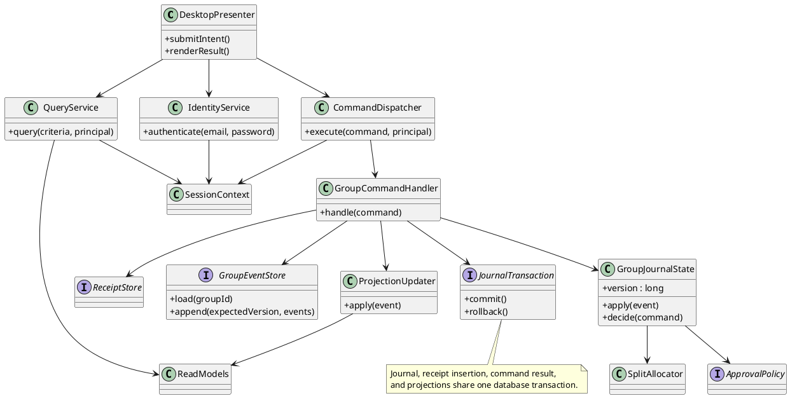
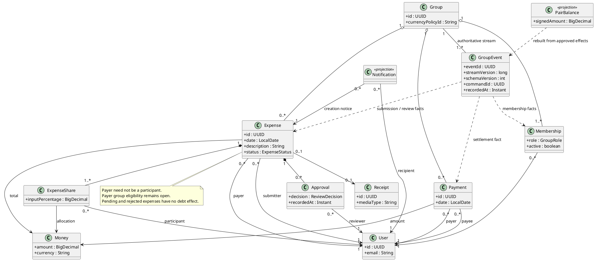
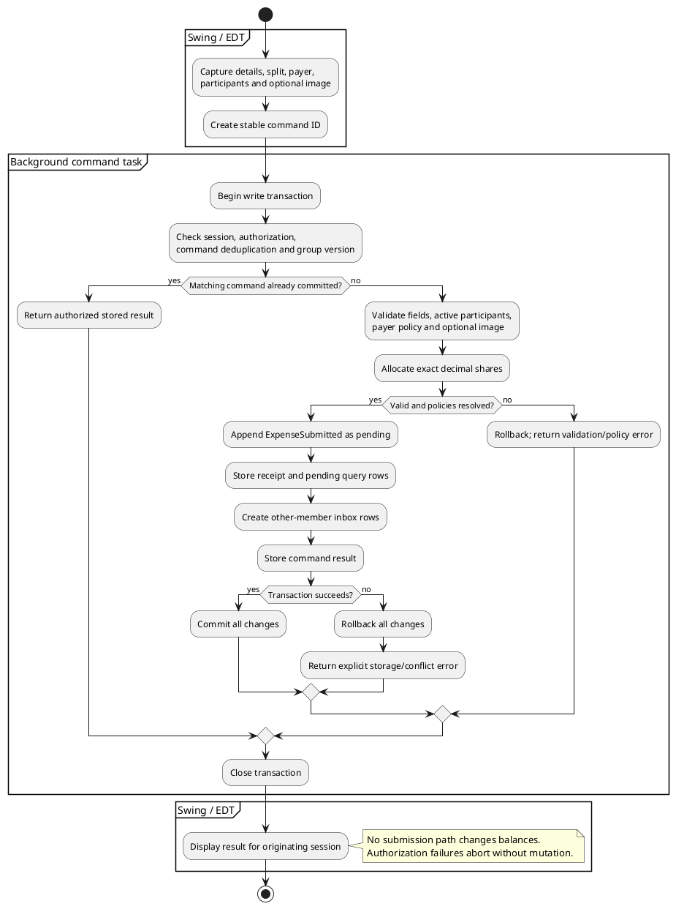
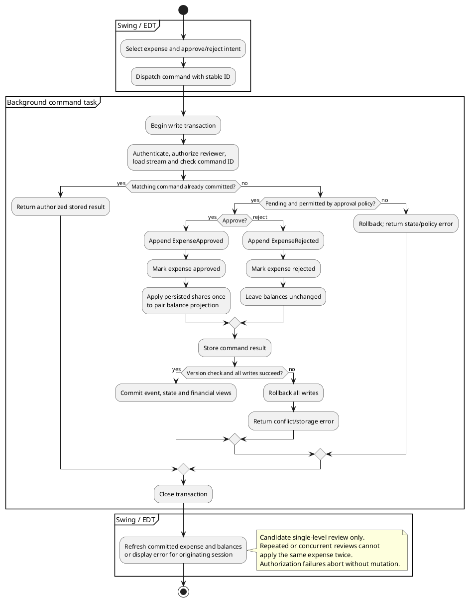

# Alternative Architecture: SplitSmart Event-Journal Modular Monolith

**Date:** 2026-11-05  
**Status:** Independent design proposal for human review; no implementation or product-scope approval implied.

## 1. Sources, scope, and baseline comparison

This proposal uses [UserRequirement.md](../../UserRequirement.md), the [constitution](../../.specify/memory/constitution.md), [spec.md](spec.md), the baseline [plan.md](plan.md), [architecture-baseline.md](architecture-baseline.md), and [tasks.md](tasks.md). The customer request remains the product authority. This document does not replace those documents, change their decisions, complete their tasks, or implement application code.

The baseline is the single-process layered architecture in `plan.md` and `architecture-baseline.md`: presentation, application use cases, domain, repository ports, and infrastructure adapters. It retains expense/payment source records and derives balances, while leaving durable storage unresolved. The separate baseline document became available during this task and was read to confirm this comparison; it was not edited.

The alternative is a **modular monolith with command/query separation (CQRS) and selective event sourcing for group activity**. It remains one Java 21 desktop process, built with Maven, with Swing presentation and JUnit 5 verification. Its defining difference is the authoritative append-only journal of group changes and separate, rebuildable query models. Accounts and credentials use conventional relational storage rather than event sourcing sensitive credentials.

| Concern | Baseline plan | Alternative proposal |
|---|---|---|
| Primary organization | Technical layers and per-feature use cases | Business modules with explicit command/query contracts |
| Group state authority | Expense, approval, membership, and payment repositories | Ordered group event streams; aggregates reconstructed from events |
| Read path | Services derive balances from source records | Dedicated transactionally maintained balance/report views |
| Write path | Use cases update repositories in a unit of work | Handlers append events and update projections in one transaction |
| Audit/recovery | Retained source records | Historical transitions plus replayable projections |
| Storage | Unresolved | Proposed embedded SQLite via JDBC, subject to approval |

This still uses inward dependencies and cohesive domain objects. Renaming layers alone would not be an alternative; event authority, reconstruction, replay, and distinct write/read models materially change the design. A broker, microservices, remote server, and eventual consistency for financial reads are unnecessary for this desktop proposal.

## 2. Modules and responsibilities

| Module / proposed types | Responsibilities and boundary |
|---|---|
| Desktop presentation: `DesktopPresenter`, Swing panels and table models | Login, groups, expense entry/detail, approval queue, balances/payment form, reports, and notifications. Capture intent and display immutable result objects. No SQL, allocation, or authorization decisions. |
| Identity: `IdentityService`, `SessionContext`, credential adapter | Email/password authentication, account access, and trusted current principal. Store salted password hashes through a reviewed password-hashing implementation; never journal passwords. Enrollment/recovery policy remains open. |
| Group command model: `CommandDispatcher`, `GroupCommandHandler`, `GroupJournalState` | Authorize and serialize group mutations; reconstruct current membership, expense states, and obligations; enforce invariants and expected stream versions. Commands include create group, manage membership, submit expense, review expense, and record payment. |
| Expense domain: `Expense`, `ExpenseShare`, `SplitAllocator`, `ApprovalPolicy` | Validate exactly one payer, amount, participants and percentages; allocate exact shares; permit explicit review transitions. Approval policy is a replaceable object whose reviewer/self-approval rules require a product decision. |
| Event persistence: `GroupEventStore`, `JournalTransaction` | Append versioned group facts with command IDs and optimistic concurrency checks. Persist events, command results, receipt references, and financial projections atomically. |
| Query side: `QueryService`, `ProjectionUpdater`, query DTOs | Read authorized membership, expense detail/review queues, pairwise balances, retained payments, and reports. Projection updates are deterministic and contain no new product decisions. |
| Notifications: `NotificationProjector`, inbox query | On expense submission, persist one in-app notice per other eligible group member. Opening the app/inbox shows stored notices; no approval or balance effects. |
| Receipts: `ReceiptStore` | Validate approved image format/size, persist bytes, and retrieve only through authorized expense queries. Decode images away from the EDT. |
| Runtime/composition | Wire modules, open/migrate storage, manage background executor, initialize projections, and start Swing on the EDT. |

Use feature-oriented Java packages such as `identity`, `groupcommands`, `expenses`, `queries`, `journal`, and `desktop`, each with internal domain and adapter boundaries. A single Maven project with standard `src/main/java` and `src/test/java` directories is sufficient. Package boundaries, interfaces, and dependency review enforce modularity without extra deployment units.

Domain objects depend on Java types and domain interfaces, never Swing or JDBC. Query DTOs do not expose credential records or mutable aggregates. Only the command coordinator can write group events; query adapters cannot bypass it to change business state.

## 3. UML class diagrams

These fenced blocks are self-contained PlantUML sources for this alternative. They intentionally do not overwrite the baseline's planned diagram files. Types and methods describe responsibilities rather than an implemented API.

### Command and query collaboration

### Domain relationships and journal facts

## 4. Data flow and consistency

### Submission and approval

The EDT reads an expense form into an immutable command with a stable command ID. A background task calls the dispatcher with the trusted session principal. The handler opens a write transaction, reconstructs the group stream, authorizes the action against current membership, and validates domain input. It does not trust user IDs or eligibility supplied by the UI.

`SplitAllocator` uses `BigDecimal` decimal inputs, approved currency scale, and exact percentage totals of 100%. Allocate whole minor units, then distribute remainders using the approved deterministic ordering. Persist final shares and the allocation-policy version in `ExpenseSubmitted`; replay must never recalculate old shares using a new policy. A payer who is also a participant incurs no debt to themselves. Supported currencies, treatment of excess input precision, remainder order, and zero-share participation require decisions before implementation.

The transaction appends `ExpenseSubmitted`, inserts the optional receipt, updates the pending-expense view, and creates inbox notices for the other current members identified at submission. It makes no balance entry. Notification recipients are recorded with the submission fact so replay does not accidentally use today's membership. Commit precedes success feedback.

A review command loads the current expense and policy, checks reviewer eligibility, and appends either `ExpenseApproved` or `ExpenseRejected`. For the candidate single-level flow, an approval transitions pending to approved once. An approval event updates the expense projection and pairwise financial projection in the same transaction. Rejection changes status without any financial entry. Multilevel workflow and editing/resubmission remain outside the candidate subset pending product decisions; an interface alone does not deliver them.

### Pairwise balances and payments

For each approved expense share owed by participant D to payer C, add a debt D→C, excluding D=C. Net opposing obligations only within the same group, currency, and unordered user pair; do not simplify debts through unrelated people or groups. Store one signed amount per pair in stable user-ID order. The positive/negative sign identifies the direction of debt, and the UI renders a nonnegative outstanding amount with explicit debtor/creditor.

`RecordPayment` validates distinct parties, authorization, a positive amount, and current debt in that direction. It rejects amounts above the debt. Within the same serialized write transaction it appends `PaymentRecorded`, retains payment detail, and subtracts the settlement from the pair position. The current stream/projection version must match before checking the amount; a stale screen is never financial authority.

For example, A pays 30.00 for equal shares for B and C, and A is outside the participants. Pending submission creates no debt. Approval creates B→A 15.00 and C→A 15.00. B's payment of 5.00 leaves B→A 10.00. A second approval has no effect; B's attempted payment of 11.00 is rejected without records or balance changes. This example assumes A meets the eventual payer-eligibility policy.

### Queries, reports, and the Swing boundary

Queries authorize the requested group/account scope before reading projections. A report reads one consistent database snapshot, validates an inclusive date range, filters expenses by expense date and payments by payment date, and includes only approved expense allocations in financial totals. Pending/rejected details can appear only in an explicitly labeled review view, never approved totals.

A range report distinguishes **period movement** from **closing outstanding balance**. Period movement uses only matching expense/payment records; closing balance requires an opening balance from earlier activity. Display any opening figure separately rather than presenting it as in-range activity. Effective expense/payment dates are distinct from journal recording time. Exact report labels, approval timing treatment, and filters beyond date range require product acceptance; this is a proposed reconciliation model, not a new requirement.

Blocking SQL, reconstruction, receipt processing, and report generation execute away from the EDT. Completion returns immutable DTOs and UI updates through the EDT. Bind work to the originating session so results arriving after logout cannot populate the next user's screen. After a write, requery committed projections before displaying success. Projection updates are synchronous for the desktop design, so there is no intentional financial read lag.

## 5. Persistence design

**Proposed technology, not an approved baseline decision:** an embedded SQLite database accessed through a JDBC adapter. One local application instance owns the database; use a single background write executor and database transactions as the ultimate concurrency boundary. Exact driver/version, durability settings, file location, and distribution licensing require review when implementing. Do not place a shared live database on a network drive or claim this design supports independent devices.

| Logical table | Contents / constraints |
|---|---|
| `users`, `credentials` | Stable user IDs, unique canonical login email, account status, hash and algorithm parameters. Credentials are separate from journal payloads. |
| `group_events` | Event ID, group ID, stream version, type/schema version, actor, command ID, recording timestamp, payload. Unique event ID and `(group_id, stream_version)`. |
| `command_results` | Unique `(actor_id, command_id)`, command fingerprint and committed result IDs; persisted atomically with effects. Reusing an ID with different content is rejected. |
| `receipts` | Image bytes, media type, checksum and stable ID; linked on successful submission. Database BLOB storage keeps receipt and event commit atomic. Size/format limits remain open. |
| `membership_view`, `expense_view`, `share_view`, `approval_view` | Rebuildable current state, history references, final shares and review details. Membership removal marks former state, preserving historical IDs. |
| `payment_view`, `pair_balance_view` | Retained settlements and group/currency/pair positions. Payment records remain in the authoritative journal if these views are rebuilt. |
| `notification_view`, `notification_read_state` | Unique `(submission_event_id, recipient_id)` inbox notices; separately persisted read state so replay preserves read/unread status. |
| `projection_metadata` | Projection schema version and last applied stream version per group; used to detect incomplete or incompatible models. |

Serialize money and percentages as canonical decimal strings plus currency/scale metadata, reconstructing `BigDecimal` exactly. Do not use SQLite floating-point columns or floating-point SQL aggregates for money; projection arithmetic and report accumulation occur in Java. Foreign keys and uniqueness constraints protect identity/reference integrity; group policy checks remain in the domain.

### Atomicity, retries, and recovery

1. Begin the serialized write transaction; check authorization and any previous command result for that actor. Return a previous result only if its fingerprint matches and current authorization permits it.
2. Read the stream and expected version, ensure projections are at that version, and validate against current state. Membership changes and payments share the group stream, preventing validation against a separately committed membership snapshot.
3. Append facts with a compare-and-set stream-version check. Update projections, receipt bytes if any, notification rows, and command result using the same database transaction/connection.
4. Commit all changes, or roll everything back. Retry a conflict by reloading and revalidating, never by blindly reusing earlier financial validation. Conflicting approve/reject actions produce one valid transition and one explicit conflict/result.

Command IDs make retries safe after a lost response, including payments. Additionally, an expense's state/version prevents a fresh command ID from approving it again. These are exactly-once **financial effects within this database**, not a promise of exactly-once network delivery.

On startup, verify database/projection versions before serving financial queries. If incompatible, enter maintenance mode, reconstruct into shadow projections from ordered events, reconcile, and atomically activate them. Replay must not resend external side effects; inbox reconstruction uses recorded audiences and unique keys. Backups include identity/credentials, journal, receipts, command results, and notification read state. Use a transaction-consistent database backup and test restoration; copying an active database file alone is not the backup design.

Events are immutable facts for application behavior. Version payload schemas and provide deterministic readers/upcasters for historical versions; do not deserialize arbitrary Java objects. Journal replay and deletion/privacy obligations can conflict. Retention, anonymization, account deletion, and backup expiration must be resolved explicitly; append-only history does not waive privacy requirements. Snapshots are an optional later optimization after measurements, not a substitute for the event history.

## 6. UML activity diagrams

### Adding an expense

### Approving or rejecting an expense

## 7. Deployment and platform limitations

Build with Java 21 and Maven; configure JUnit 5 discovery and compiler release 21 in a future implementation. A desktop release can use a packaged Java runtime and platform-specific installer. Build/sign installers and test filesystem permissions, database/driver loading, image handling, migrations, and UI behavior on each approved desktop OS. Store writable application data outside installation files and the repository. Back up before schema upgrades and document recovery to a compatible application/database pair.

The initial topology is one desktop process, an embedded database, and users logging in sequentially against that installation. Notifications for another local account remain in its inbox until it logs in. Local logical account authorization cannot protect the database from a machine administrator or someone with direct file access; file permissions, device protection, and any required encryption need an explicit security decision. Multiple accounts do not imply multi-device collaboration.

Swing provides desktop windows, not browser pages or Android/iOS apps. It does not provide shared hosted identity/data, cross-device synchronization, mobile lifecycle/touch integration, mobile push delivery, or web deployment. Thus **NFR-001, User Story 6, and SC-005 remain unmet**. Desktop delivery also requires installing/updating clients, unlike accessing a hosted web application. Accessibility and responsiveness require explicit testing and agreed criteria rather than assumptions about Swing widgets.

A future shared service could host the command/query core and authoritative database, exposing authenticated APIs to Swing, web, and mobile clients. That is a separate architecture/delivery decision requiring server security, API contracts, concurrency, operations, new clients, and cross-platform acceptance tests. The proposed module boundaries permit reuse; they do not supply those capabilities today. Do not synchronize independent local journals by merging files.

## 8. Advantages, disadvantages, and trade-offs

| Decision | Advantage | Cost / limitation |
|---|---|---|
| Journal authority | Explains how state changed; financial projections can be rebuilt and independently reconciled | Event schema evolution, replay correctness, and privacy lifecycle are harder than ordinary CRUD |
| Separate write/read models | Approval queue, inbox, and reports have focused query shapes | More models and mapping code; incorrect projections can mislead users without reconciliation |
| Synchronous projection transaction | Approval/payment success immediately agrees with financial reads; simple crash boundary | All projection work adds write latency; slow projectors block writes |
| One ordered stream per group | Membership, review, and settlement validation see one consistent history | Large/busy groups create contention and costly reconstruction; profile before introducing snapshots or finer streams |
| Embedded database and receipt BLOBs | No database server; atomic receipt submission and simpler complete backups | Database size and installer/driver management; one-installation scope and explicit image limits |
| Modular monolith | Independently testable rules and fewer operational components | Package discipline is needed; there is no process-level fault isolation |

For a small classroom MVP, the baseline is simpler to implement and maintain. This alternative is most useful if auditability, replay, and dedicated financial query models justify its additional complexity. It does not improve platform coverage or eliminate product decisions. Selecting it would require reviewing its complexity against the expected dataset and team capacity.

## 9. Requirement traceability and proposed verification

The following is a verification plan, not passing evidence. JUnit 5 tests run independently of Swing through Maven; durable transaction/replay tests must use the selected database adapter rather than only in-memory doubles.

| Requirements | Alternative responsibility | Proposed observable verification |
|---|---|---|
| FR-001, FR-002 | Identity/session and authorization on every command/query | Two-account login, invalid credentials, private account isolation, unauthorized group/receipt denial, and logout during background work |
| FR-003, FR-004, FR-019 | Group journal membership facts and reconstructed current membership | Creator/admin authorization, former-member exclusion from new expenses, preserved history and balances after restart/replay |
| FR-005–FR-008 | Expense command, allocator, receipt transaction | Required fields, one payer outside participants, active participants, positive amounts, exact percentages, optional receipt round trip and rollback |
| FR-009 | Submission audience and inbox projection | Other current members receive one notice per submission, including after replay/retry; approval state unchanged |
| FR-010–FR-012 | Review transition and atomic projection updates | Pending/rejected zero effect; approved effect once; repeated IDs, new-ID repeated review, conflicting concurrent review, crash before/after commit |
| FR-013 | Signed pair projection and independent journal fold | Approved shares minus payments reconcile by group/currency/pair; payer self-share excluded; opposing obligations net correctly |
| FR-014, FR-015, FR-020 | Payment command and journal facts | Partial/full acceptance, nonpositive/overpayment denial without mutation, retry deduplication, competing payments, persistence after restart |
| FR-016–FR-018 | Authorized report queries and snapshot reads | Inclusive dates, invalid-range denial, selected filters, pending exclusion, period movement/opening/closing reconciliation |
| NFR-001 | Separate future platform delivery | Explicitly unsupported by this design; requires web/Android/iOS journey and synchronization evidence |
| NFR-002 | Decimal allocator and persisted shares | Remainder conservation for equal/percentage splits, small totals/many participants, deterministic replay under policy changes |
| NFR-003 | Background work and EDT result dispatch | Delayed I/O does not freeze UI; result/error updates occur on EDT; agreed latency bounds remain open |
| NFR-004 | Pure domain and command/query interfaces | Headless rule tests plus actual-database rollback/replay/integration tests |
| NFR-005 | Human artifact review | Review requirements, diagrams, security, arithmetic, and deployment claims before acceptance |

AC-001 requires a future evidence artifact for every accepted FR. AC-002–AC-004 map to approval exclusion/idempotency, allocation conservation, and pair reconciliation tests above. AC-005 maps to report scope/reconciliation tests; AC-006 maps to release/document review for accurate platform claims. SC-001–SC-004 require the specified complete acceptance scenario outcomes, while SC-005 remains blocked on actual web/mobile delivery.

## 10. Decisions still required

All unresolved questions in `spec.md` and the baseline's T001–T005 gates remain open. In particular: approve the desktop milestone separately from web/mobile delivery; choose durable storage and backup expectations; confirm currency/rounding order and zero-share rules; determine payer group eligibility; settle enrollment/recovery and group admin lifecycle; specify reviewer selection/self-approval and rejection/correction behavior; agree notifications, payment corrections, report filters/export, and measurable operational/security/accessibility targets.

Alternative-specific decisions are whether journal/replay complexity is warranted, whether SQLite and receipt BLOB storage are acceptable, the supported local collaboration model, event retention/privacy rules, image limits, and migration/recovery acceptance criteria. These are proposed implementation decisions, not customer-stated requirements. This document is reviewable independently; accepting it must not be inferred from its creation, and neither the baseline nor existing requirements are changed here.
