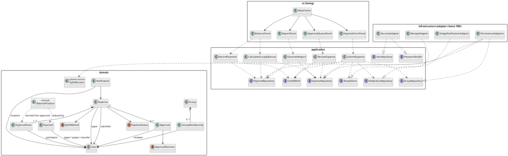
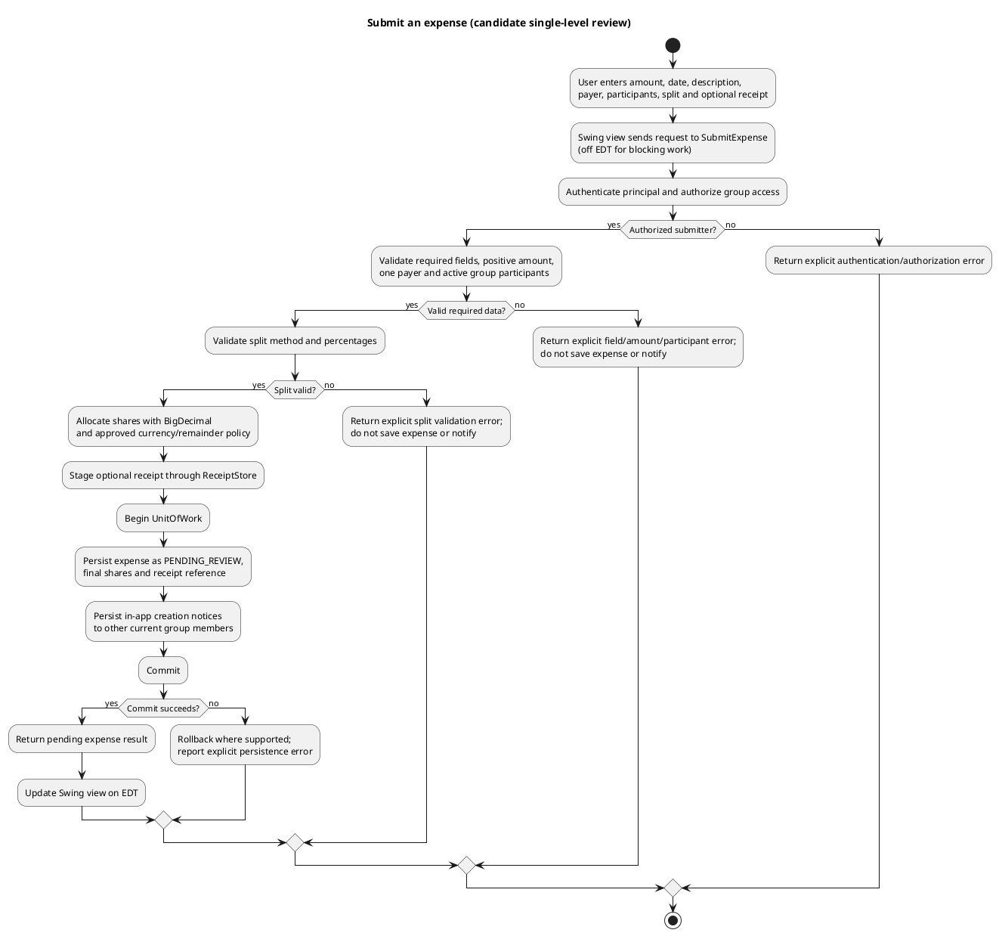
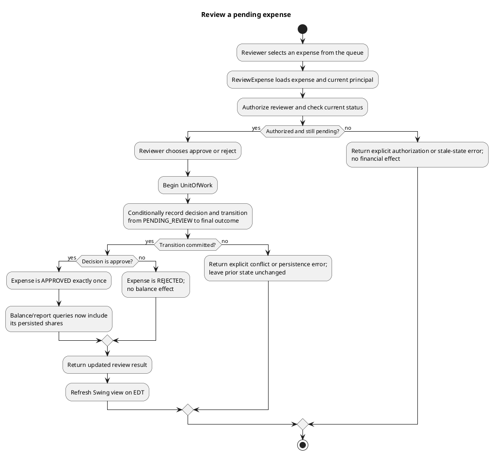
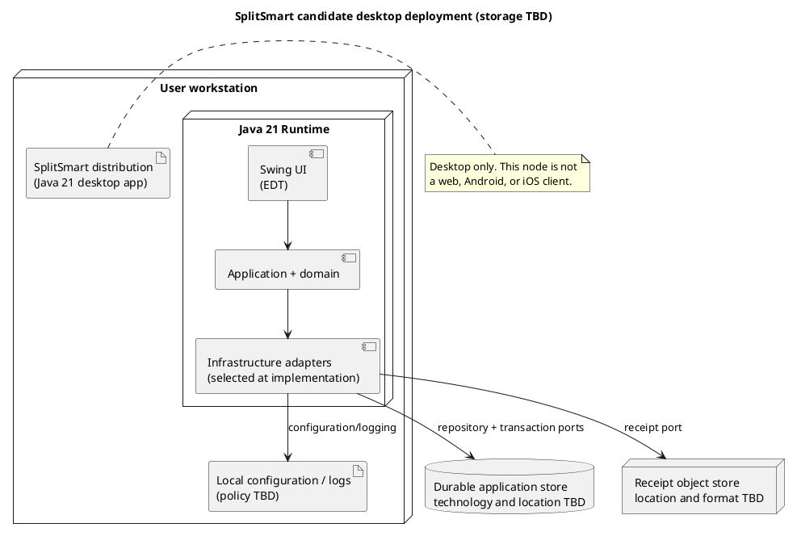

# SplitSmart Baseline Software Architecture

**Status:** Proposed architecture baseline; documentation only

**Feature:** `001-splitsmart-feature`

**Source artifacts:** `UserRequirement.md`, `.specify/memory/constitution.md`, `spec.md`, `plan.md`, and `tasks.md`
**Technology baseline:** Java 21, Maven, Java Swing, JUnit 5, PlantUML

## 1. Purpose, scope, and constraints

This document defines a candidate architecture for the Java Swing desktop MVP described in `plan.md`. It does not authorize implementation, select unresolved product policies, or change any source requirement.

The original customer asks for a primarily web-based product and Android and iOS apps. A Java Swing application is a desktop application and **does not satisfy that platform requirement (NFR-001 / US6)**. Treat this as a proposed desktop milestone only; product-owner acceptance of the platform gap remains a gate. Web and mobile clients, shared online services, and cross-platform synchronization are outside this deployment baseline.

The architecture follows the constitution and plan:

- Java 21 and Maven, using the conventional `src/main/java`, `src/main/resources`, `src/test/java`, and `src/test/resources` layout.
- Swing is restricted to the presentation boundary. Domain and application behavior is testable without Swing.
- `BigDecimal` is used for monetary values and calculations. Currency precision, rounding, and deterministic remainder ordering are applied only under an approved policy; supported currencies and ordering remain open decisions.
- JUnit 5 verifies observable behavior. Successful compilation alone is not acceptance evidence.
- The candidate MVP uses a single-level approval flow. Configurable multiple approval levels remain in the full requirements inventory.
- Concrete durable storage, receipt storage, transaction capabilities, backup/restore, and distribution are not selected. In-memory test doubles do not satisfy durability.

## 2. Layered architecture

Use a single-process, dependency-inward design. Presentation invokes application use cases; application depends on domain types and its own ports; infrastructure implements those ports. The domain has no dependency on Swing, Maven internals, or persistence technology. The composition root is the only place that wires concrete adapters.

| Layer / package | Responsibilities | Must not do |
|---|---|---|
| **Presentation — `ui`** | `MainFrame`, login, group, expense, approval, balance/payment, and report screens; input formatting; display view state, validation errors, and results; delegate user intent to use cases. Keep Swing state changes on the Event Dispatch Thread (EDT). Run potentially blocking storage and receipt I/O off the EDT, then marshal results to the EDT. | Access repositories directly; calculate splits, approvals, balances, payment eligibility, or report totals; swallow errors or show success when a use case failed. |
| **Application — `application`** | Use cases such as `AuthenticateUser`, `CreateGroup`, `ManageMembership`, `SubmitExpense`, `ReviewExpense`, `RecordPayment`, `CalculateGroupBalances`, and `GenerateReport`. Coordinate the current principal, authorization, domain operations, repository ports, transaction boundaries, and notification behavior. Return explicit results/errors to presentation. | Depend on Swing widgets or a specific storage engine; duplicate domain rules in controllers. |
| **Domain — `domain`** | Encapsulate identity, group membership/history, expense and share invariants, approval state transitions, payment records, money policy abstractions, balance derivation, and report-relevant concepts. Keep split allocation deterministic and pure; persist final shares so future policy changes do not recalculate historical allocations. | Perform I/O or depend on UI, database, or runtime framework classes; use `float` or `double` for money. |
| **Ports — `application.port`** | Define required capabilities: repositories, `UnitOfWork`/transaction boundary, current-user access, password verification, receipt storage, and notification persistence/delivery. Interfaces express what use cases need without selecting adapters. | Embed implementation-specific behavior or silently provide volatile storage as production persistence. |
| **Infrastructure — `infrastructure`** | Implement persistence, transaction, security, receipt, and in-app notification ports once product and operational decisions are approved. Map stored records to domain objects and surface adapter failures explicitly. | Leak storage concerns into Swing or domain objects; claim durable behavior before a durable adapter is selected. |
| **Composition/bootstrap — `config`** | `SplitSmartApplication` and `ApplicationComposition` construct adapters, services/use cases, controllers, and the initial view; launch Swing on the EDT. | Become a second location for business rules or mutable UI state. |

### Candidate project organization

```text
pom.xml
src/
├── main/
│   ├── java/com/splitsmart/
│   │   ├── SplitSmartApplication.java
│   │   ├── config/
│   │   ├── domain/{user,group,expense,payment,balance}/
│   │   ├── application/{account,groups,expenses,approvals,payments,reports,port}/
│   │   ├── infrastructure/{persistence,receipts,notifications,security}/
│   │   └── ui/{common,login,groups,expenses,approvals,balances,reports}/
│   └── resources/
└── test/
    ├── java/com/splitsmart/{domain,application,infrastructure,ui}/
    └── resources/
```

These are proposed package boundaries, consistent with the plan, not an implemented API contract.

## 3. Component responsibilities and key domain concepts

- **Identity and access:** `User` represents an account, not its raw credential. `AccountService` / `AuthenticateUser`, `UserRepository`, and `PasswordVerifier` handle sign-in and current-user access. Enrollment, recovery, password policy, and credential-storage details need decisions.
- **Groups:** `Group`, `GroupMembership`, and `GroupRole` model active and former members. Membership changes are authorized for the creator/delegated admins; former membership remains addressable for historical records but does not permit new participation. Delegation mechanics remain open.
- **Expenses and allocation:** `Expense` holds group, submitter, exactly one payer, amount/currency, date, description, split method, optional receipt reference, status, and final `ExpenseShare` records. A pure `SplitAllocator` supports equal and percentage splits, validates the confirmed rules, and guarantees shares sum to the total at approved currency precision.
- **Approval:** `Approval` records reviewer, decision, and time. The candidate MVP accepts an authorized decision only while the expense is pending. The pending-to-approved transition is atomic and repeat-safe; reviewer selection, self-approval, rejection/correction, and multilevel policy remain unresolved.
- **Notifications:** `NotificationService` creates in-app notices for other current group members when an expense is submitted. A notice is informational and does not approve an expense or change balances.
- **Balances:** `BalanceService` derives group-scoped pairwise positions from approved expense shares and recorded payments. Balances are a read model, not an independently authoritative transaction. Payer/participant netting is applied only under confirmed group and payer semantics.
- **Payments:** `Payment` is an auditable positive transfer with payer, payee, group, amount/currency, date, and recorder. `RecordPayment` validates that a payment does not exceed the current outstanding amount and commits only if the validation and write can be made atomic.
- **Reports:** `GenerateReport` authorizes scope, validates an inclusive date range, and summarizes expenses, payments, and derived balances for selected parameters. Parameters beyond the date range and any export formats need product decisions.
- **Swing screens:** A shared `MainFrame` provides navigation; panels/dialogs show forms and results. Any controller/presenter translates view events to use-case calls and explicit outcomes.

## 4. Data flow and persistence design

### 4.1 General request flow

1. A Swing view gathers input and sends a request to an application use case through a controller/presenter.
2. The use case obtains the authenticated principal, checks authorization and group membership, and validates request-level requirements.
3. Domain objects/services enforce invariants and calculate allocations using exact decimal arithmetic.
4. The use case opens the required transaction through `UnitOfWork`, persists authoritative records via repository ports, and commits. Any failure is surfaced; rejected requests do not create success-shaped results.
5. The use case returns an explicit result or error. Potentially blocking work executes off the EDT; the view is updated on the EDT.
6. Balances and reports are calculated from authorized, committed source records. Pending and rejected expenses are excluded.

### 4.2 Conceptual persisted records

The following is a logical model, not a selected database schema. Stable IDs and relationships are expected; physical schema, migrations, retention, deletion/anonymization, and indexes await the storage decision.

| Record | Core fields / relationships | Persistence rule |
|---|---|---|
| `User` | ID, display name, email, account status; credential material belongs behind a separate security boundary. | Never persist plaintext passwords. Enrollment and credential policy are open. |
| `Group` | ID, name, creator, creation metadata, currency/group policy. | Currency scope and policy are open. |
| `GroupMembership` | Group ID, user ID, role, active/former state, joined/left times. | Retain history; do not erase a former member's financial records. |
| `Expense` | ID, group ID, submitter, exactly one payer, amount, currency, expense date, description, split method, receipt reference, review status, creation metadata. | A submission is pending review. Persist status transitions and final shares. |
| `ExpenseShare` | Expense ID, participant ID, final allocated amount, optional entered percentage. | Shares are at currency scale, non-negative under the selected policy, and sum exactly to the expense total. |
| `Approval` | Expense ID, reviewer ID, decision, timestamp, optional note/stage. | Record the review outcome with the status transition; stage policy beyond the candidate single level is open. |
| `Payment` | ID, group ID, payer, payee, positive amount/currency, payment date, recorder, creation metadata. | Keep an auditable source record; reversal/correction rules are open. |
| `Notification` | Recipient, group, expense, event type, creation time, read state. | Creation event is in-app and does not alter expense state. |
| Receipt object/reference | Opaque reference, media metadata, access scope. | Store image bytes through a receipt port; location, limits, backup, access controls, and atomicity are undecided. |

### 4.3 Consistency and derived views

- **Expense submission:** Validate positive amount, required fields, exactly one payer, active group participants, and valid equal/percentage split. Percentage values must be non-negative and total exactly 100%. Calculate and persist final shares. Save the pending expense, its shares, receipt reference (if any), and creation notifications within a consistency boundary where the selected adapter permits it. If receipt bytes live outside the transaction store, define a staged-upload/cleanup or other failure-recovery policy before implementation.
- **Approval:** In one transaction, confirm the expense is still pending, authorize the reviewer, record the decision, and change status. Approval must be repeat-safe (for example, a conditional pending-state transition plus uniqueness/idempotency protection). With balances derived from approved shares, the status change is the financial source-of-truth transition; do not independently post the same effect twice.
- **Balances:** Derive obligations by group, currency, debtor, and creditor from approved shares and payer credits, then subtract applicable recorded payments. If the payer is also a participant, net that participant's own share. The payer is confirmed to be allowed outside the participant set, but whether they must be a group member and how an outside-group payer is represented remain unresolved; do not finalize those balance semantics without a decision.
- **Payment:** Read the current pairwise outstanding amount and persist the payment atomically with the overpayment check. Concurrent/retried submissions must not allow aggregate payments to exceed the outstanding amount; the selected store must provide adequate transaction isolation/locking or an equivalent conditional update. A rejected payment leaves history and balance unchanged.
- **Reports:** Authorize the requested group/personal scope before querying. Use inclusive date-range boundaries and apply only confirmed filters. Reconcile results against the same approved expenses and recorded payments included by the report's scope and filters.
- **Notifications:** For a local-only MVP, store in-app notification records with the submission where possible so a committed expense is not silently missing its creation notice. If a separate delivery boundary is later introduced, use durable retryable intent (such as an outbox) rather than allowing notification failure to reverse or approve an expense.
- **Durability boundary:** Repositories and transaction interfaces are part of the baseline; no particular database, file format, ORM, or remote service is selected. Production use requires an approved durable implementation, receipt storage, migration, backup/restore, and recovery design. In-memory adapters are for tests only.

## 5. UML class diagram

The diagram shows candidate concepts and boundaries, not final signatures or a concrete persistence adapter.



## 6. UML activity diagrams

### 6.1 Add/submit an expense



If receipt bytes are not part of the same transaction as expense records, the receipt staging and cleanup/retry behavior must be defined by the selected adapter. A pending expense has no balance effect.

### 6.2 Approve or reject an expense



Approval policy in this diagram is a candidate single-level flow. Reviewer selection, self-approval, rejection notes, editing/resubmission, multilevel policy, and status-change notices require product decisions. Repeated approval must not create another balance effect.

## 7. Deployment architecture and operational considerations

### 7.1 Candidate deployment topology

This baseline deploys one Java desktop process on a user's workstation. It has no application server or cross-device synchronization service. The storage and receipt endpoints are explicit placeholders because neither their technology nor local-versus-central placement has been decided.



The diagram distinguishes the desktop process from durable storage; it does not prescribe whether storage runs locally or remotely. Deployment architecture must be revisited after the storage, concurrency, backup, and distribution decisions.

### 7.2 Release, security, and operations considerations

- **Runtime and packaging:** Target Java 21. Choose how the runtime is supplied (installed JVM versus bundled runtime) and how builds are signed/distributed after the supported OS matrix is agreed. Maven is the reproducible build/test tool. No packaging tool or OS support matrix is selected here.
- **Persistence and backup:** Select a durable store and transaction model before claiming restart survival or production readiness. Specify schema/migrations, backup frequency, restore procedure, data retention, and recovery tests. Keep receipts in an access-controlled store and back them up consistently with references.
- **Credentials and privacy:** Do not store plaintext passwords. Select and review a credential-verification and secret-handling design before implementation. Enforce group/personal authorization in use cases, not only in the UI. Restrict receipt retrieval to authorized users. Privacy, retention, and security acceptance thresholds remain open.
- **Transactions and concurrency:** Approval state changes and payment overpayment checks require atomicity. Establish supported concurrency and isolation expectations with the storage choice; single-process desktop assumptions do not by themselves guarantee safe concurrent writes to shared storage.
- **EDT responsiveness:** Keep storage/image operations off the EDT, report progress or errors explicitly where appropriate, and marshal view updates back to the EDT. Response-time and data-volume targets remain unspecified.
- **Logging and diagnostics:** Define a privacy-aware logging policy. Never log passwords, receipt contents, or unnecessary personal/financial data. Surface actionable operational failures without exposing sensitive details.
- **Upgrade and recovery:** Test data migration and recovery before releasing changes that alter persisted records. Rebuild derived balances from authoritative expenses, shares, and payments where needed; do not treat a cached balance as the only financial record.
- **Platform boundary:** Desktop-only distribution does not satisfy NFR-001 / US6 or SC-005. A future primary web product and Android/iOS applications need separately approved client/server architecture, authentication, synchronization, deployment, and acceptance criteria.

## 8. Verification architecture (Maven / JUnit 5)

Configure Maven compilation for Java 21 and use JUnit Jupiter with Maven Surefire. Exact dependency/plugin versions belong in the future Maven configuration; this document does not modify it.

| Test level | Test focus | Required evidence |
|---|---|---|
| Domain unit tests | Equal and percentage splits; positive amounts; exact share conservation; remainder allocation under selected policy; expense state transitions; pairwise netting; payment constraints; report range boundaries. | Deterministic JUnit 5 tests with valid, boundary, and invalid cases; no Swing required. |
| Application tests | Authentication/authorization; active membership; pending expense submission; notification audience; approval exactly once; rejected/pending balance exclusion; payment atomicity; report scope. | In-memory repository/port test doubles; assert rejected operations leave records and balances unchanged. |
| Persistence integration tests | Repository mapping/reload, transaction boundaries, former-member history, migrations, receipt references, backup/restore as supported. | Run only against the approved durable adapter; in-memory tests are not persistence evidence. |
| Swing boundary tests | Navigation, input/error presentation, EDT rules, and asynchronous operation dispatch. | Headless tests where reliable plus a manual desktop acceptance checklist; domain arithmetic is not tested through the GUI. |
| Traceability / acceptance | Each accepted FR, AC, and supported candidate user story. | Link requirement IDs to test or review evidence; explicitly mark unresolved and unmet platform scope. |
| Human review | Requirement alignment, monetary correctness, security/privacy boundaries, diagram consistency. | Human review before generated artifacts or implementation are accepted, as required by the constitution. |

Minimum financial invariants to verify: shares sum exactly to the expense total; pending/rejected expenses have no balance effect; approval applies once; payment amount is positive and cannot exceed current outstanding debt; reports reconcile to their included records.

## 9. Requirement alignment and coverage

| Requirement | Architectural response | Coverage / caveat |
|---|---|---|
| FR-001–FR-002: accounts, sign-in, privacy and group access | Identity/application services, credential-verification port, authenticated principal, use-case authorization. | Account enrollment, recovery, and credential policy need decisions and security review. |
| FR-003–FR-004, FR-019: group management, active participants, historical members | Group and membership domain model; authorized group use cases; retained former membership. | Invitation/delegation lifecycle remains open. |
| FR-005–FR-008: expense details, payer, equal/percentage splits, validation, receipt | `Expense`, final `ExpenseShare` records, `SplitAllocator`, receipt port, submission use case. | Exactly one payer and payer outside participants are acknowledged; payer group eligibility and zero-share semantics remain open. |
| FR-009: expense creation notice | In-app notification use case/adapter associated with submission. | Notify other current group members on creation; other event types/audience details remain open. |
| FR-010–FR-012: review, approval/rejection, no duplicate effect | Explicit pending/approved/rejected states; atomic review use case; derived balances from approved records. | Candidate architecture is single-level; configurable multilevel behavior and reviewer policy remain open. |
| FR-013: pairwise balances | Derived group-scoped balance read model from approved shares and payments. | Payer membership and group-scoped representation need confirmation before final semantics. |
| FR-014–FR-015, FR-020: payment recording and overpayment rejection | Auditable payment source records; atomic outstanding-balance validation and write. | Payment correction/reversal behavior remains open. |
| FR-016–FR-018: reports and reconciliation | Authorized report use case with inclusive date range and selected filters; totals derived from source records. | Filters beyond date range and export behavior remain open. |
| NFR-001 / US6 / SC-005: primary web, Android, iOS | Explicitly shown as outside this Swing deployment baseline. | **Not satisfied by this architecture.** Separate platform architecture and delivery are required. |
| NFR-002 / AC-003: exact monetary arithmetic | `BigDecimal`, explicit currency policy, persisted final shares, deterministic remainder allocation. | Currency set, precision, and stable ordering are decision gates. |
| NFR-003: Swing responsiveness | Background execution for potentially blocking work; EDT-only UI updates. | Numeric response-time threshold and supported dataset size are open. |
| NFR-004 / AC-001–AC-005: verifiable behavior | JUnit 5 domain/application/integration/UI test levels and requirement traceability. | Evidence must be produced for accepted requirements; compilation is insufficient. |
| NFR-005 / AC-006: human review and accurate platform claims | Human review gate; documentation labels desktop scope and unmet platforms. | Required before acceptance or any complete-product claim. |

## 10. Decision gates retained from the source artifacts

Before implementing affected behavior, obtain decisions for: desktop-milestone/platform approval; durable storage, transactions, backup/restore, receipt storage, and distribution; supported currencies and remainder ordering; payer group eligibility and outside-group balance representation; zero-share participants; account lifecycle/security; group invitations/admin delegation; approval and rejection/correction policy; notification audience; payment corrections; report filters/exports; and measurable quality, privacy, retention, and scale targets.

These gates are preserved from the spec and plan rather than resolved by this architecture. The original `UserRequirement.md` remains authoritative and unchanged.
