# SplitSmart Consolidated Design — CIS 285 Lab 7

**Date:** 2026-11-05  
**Status:** Documentation design; no application implementation or verification evidence.

This design realizes the [selected layered architecture](architecture-selected.md), [specification](spec.md) and [plan](plan.md). [Traceability](requirements-traceability.md) maps requirements to the diagrams below. Both original architecture proposals remain unchanged. G1–G8 in the selected architecture are open; diagrams show intended boundaries, not decisions resolving those gates.

## Components and data flow

| Component | Responsibility |
|---|---|
| `AccountService`, `UserRepository`, `PasswordVerifier`, `CurrentSession` | Authenticate email/password; trusted principal; private account authorization; no raw credential in domain User |
| `GroupService`, `GroupRepository` | Creator/delegated-admin membership changes; active eligibility; preserve former membership and financial history |
| `SubmitExpense`, `ExpenseRepository`, `SplitAllocator`, `ReceiptStore`, `NotificationRepository` | Validate input and membership inside transaction; persist pending expense/final shares/receipt reference and in-app notices |
| `ReviewExpense`, `ApprovalPolicy` | Authorize current reviewer; conditional pending transition; commit review and status together |
| `BalanceService`, `RecordPayment`, `PaymentRepository` | Derive pairwise debt from approved shares/payments; atomic settlement eligibility and insertion |
| `GenerateReport` | Authorized consistent reads, inclusive date filters, validated scope and reconciled totals |
| `UnitOfWork`, `OperationRepository` | Durable atomic transactions, concurrency coordination and retry-result identity |
| Swing views/presenters and composition | Gather/render immutable DTOs, background I/O, session-checked EDT delivery; wire adapters at bootstrap |

For all use cases, authoritative authorization and rules live outside presentation. The application obtains the trusted principal, begins the required consistency boundary, reads current membership/records, validates domain behavior, writes through ports, and commits. Success is shown only after commit. Conflicts and adapter failures roll back and return explicit errors. A retry reloads and revalidates current state.

The same repository model supports ordinary reads and writes; separate use-case names do not introduce CQRS. No journal or projection store exists. JDBC/database dependencies, if selected, stay inside infrastructure.

## Conceptual data model

| Record/value | Fields and invariants |
|---|---|
| User / credential record | Stable ID, display name, unique login email, status; reviewed salted password hash/parameters behind security adapter, never plaintext |
| Group / GroupMembership | Group ID/name/creator; user role and joined/left/status history; only current participants for new expenses; creator/delegated admin manages membership |
| Expense | ID, group, submitter, exactly one payer, positive Money, date, description, split method, pending/approved/rejected status, version and optional receipt reference |
| ExpenseShare | Unique expense/participant, final BigDecimal amount, optional entered percentage; share total equals expense total at approved currency precision |
| Approval | Expense/reviewer, decision, actor/time metadata; conditional transition enforces one final decision for candidate single-level policy |
| Payment | ID, group, payer/payee, positive Money, date, recorder/time; retained settlement source record; no overpayment |
| Notification | Recipient, expense/group, creation time, read state; uniqueness per expense/recipient prevents duplicate creation notices |
| Receipt reference | Opaque ID, media metadata/access scope; image limits/storage/retention remain G2/G8 |
| Operation result | Actor, operation kind, stable request key, input fingerprint, committed result reference; unique key and atomic persistence |
| BalancePosition / ReportResult | Derived values, explicit scope/currency; not separately authoritative persisted financial state |

Store decimal values losslessly; exact database decimal or canonical text mapping depends on the adapter. Never use binary floating point for money or monetary SQL accumulation. Use stable references/foreign keys where supported; removing membership must not cascade-delete financial history. Schema migrations and retention policies need approval.

## Monetary and transaction design

`SplitAllocator` accepts decimal text converted to `BigDecimal`, a nonempty unique active participant set, and approved currency/remainder policies. Equal and percentage allocations produce whole minor-unit shares with deterministic remainder distribution. Percentages are nonnegative and total exactly 100%; zero-share participation remains G3. Persist final shares so later policy changes do not recalculate history. Excess-precision handling and currency scope remain open.

`BalanceService` includes only approved expense shares, excludes payer-to-self obligations, and subtracts applicable payments within the same group/currency/user pair. Net opposing pair obligations without redirecting debt through unrelated users. Payer-outside-participants behavior is supported; payer-outside-group semantics remain G4. For example, an eligible A paying 30.00 for B and C creates no pending debt; approval creates B→A and C→A of 15.00 each; B's payment of 5.00 leaves 10.00. A second approval cannot add debt; an 11.00 B→A payment fails without mutation.

Submission stores pending expense/shares, operation result and creation notifications in one transaction. Other-current-member recipients are determined at submission, with no status change caused by notices. If receipt bytes are outside that store, stage and validate them before commit with an approved cleanup/retry protocol; failed staging must not create a successful expense. Do not perform unbounded image work under a database lock.

Review commits the approval record and conditional status/version transition atomically. No independent balance-posting write is needed: approved records become eligible for derivation once. Concurrent approve/reject attempts permit one valid transition; others receive an explicit conflict or authorized prior result.

Payment checks authorization, positive amount and current directed outstanding debt in the same isolation boundary as insertion. The adapter's coordination must cover competing settlements and relevant approval/source changes, not just a payment row lock. Persist operation identity and payment together so a retry after response loss cannot create a second settlement. Test two concurrent payments whose combined amount would overpay.

Report generation reads a consistent snapshot of authorized records. Inclusive date filters and selected parameters must match the reconciliation scope. A period's movement is not automatically its closing outstanding balance: any opening figure must be separately identified. Expense date versus approval-time treatment, labels and extra filters remain G8; no new report semantics are silently accepted.

## Class diagram

Diagram D1 covers application collaboration and domain cardinalities. Ports are application-owned; infrastructure implements them. Signatures and types are conceptual.

```plantuml
@startuml selected-class-model
skinparam classAttributeIconSize 0
package "ui" {
  class DesktopPresenter
}
package "application" {
  class AccountService
  class GroupService
  class SubmitExpense
  class ReviewExpense
  class RecordPayment
  class GenerateReport
  interface UnitOfWork
  interface UserRepository
  interface GroupRepository
  interface ExpenseRepository
  interface PaymentRepository
  interface NotificationRepository
  interface OperationRepository
  interface ReceiptStore
  interface PasswordVerifier
  interface CurrentSession
}
package "domain" {
  class User
  class Group
  class GroupMembership
  class Expense {
    amount : BigDecimal
    status : ExpenseStatus
    version : long
  }
  class ExpenseShare {
    amount : BigDecimal
    percentage : BigDecimal
  }
  class Approval
  class Payment {
    amount : BigDecimal
  }
  class Notification
  class ReceiptReference
  class SplitAllocator
  interface ApprovalPolicy
  class BalanceService
  class BalancePosition <<derived>>
}
package "infrastructure" {
  class DurableRepositoryAdapters
  class TransactionAdapter
  class CredentialAdapter
  class ReceiptAdapter
}
DesktopPresenter --> AccountService
DesktopPresenter --> GroupService
DesktopPresenter --> SubmitExpense
DesktopPresenter --> ReviewExpense
DesktopPresenter --> RecordPayment
DesktopPresenter --> GenerateReport
AccountService --> UserRepository
AccountService --> PasswordVerifier
GroupService --> GroupRepository
SubmitExpense --> GroupRepository
SubmitExpense --> ExpenseRepository
SubmitExpense --> SplitAllocator
SubmitExpense --> ReceiptStore
SubmitExpense --> NotificationRepository
ReviewExpense --> ExpenseRepository
ReviewExpense --> ApprovalPolicy
RecordPayment --> PaymentRepository
RecordPayment --> ExpenseRepository
RecordPayment --> BalanceService
GenerateReport --> ExpenseRepository
GenerateReport --> PaymentRepository
GenerateReport --> BalanceService
SubmitExpense --> UnitOfWork
ReviewExpense --> UnitOfWork
RecordPayment --> UnitOfWork
GroupService --> UnitOfWork
SubmitExpense --> OperationRepository
ReviewExpense --> OperationRepository
RecordPayment --> OperationRepository
AccountService --> CurrentSession
GroupService --> CurrentSession
SubmitExpense --> CurrentSession
ReviewExpense --> CurrentSession
RecordPayment --> CurrentSession
GenerateReport --> CurrentSession
Group "1" o-- "1..*" GroupMembership
GroupMembership "0..*" --> "1" User
Group "1" o-- "0..*" Expense
Expense "1" *-- "1..*" ExpenseShare
ExpenseShare "0..*" --> "1" User : participant
Expense "0..*" --> "1" User : payer
Expense "0..*" --> "1" User : submitter
Expense "1" *-- "0..1" Approval : candidate single level
Approval "0..*" --> "1" User : reviewer
Expense --> "0..1" ReceiptReference
Group "1" o-- "0..*" Payment
Payment "0..*" --> "1" User : payer
Payment "0..*" --> "1" User : payee
Notification "0..*" --> "1" User : recipient
Notification "0..*" --> "1" Expense
BalanceService ..> Expense : approved shares only
BalanceService ..> Payment
BalanceService --> BalancePosition
DurableRepositoryAdapters ..|> UserRepository
DurableRepositoryAdapters ..|> GroupRepository
DurableRepositoryAdapters ..|> ExpenseRepository
DurableRepositoryAdapters ..|> PaymentRepository
DurableRepositoryAdapters ..|> NotificationRepository
DurableRepositoryAdapters ..|> OperationRepository
TransactionAdapter ..|> UnitOfWork
CredentialAdapter ..|> PasswordVerifier
ReceiptAdapter ..|> ReceiptStore
@enduml
```



## Expense submission activity

Diagram D2: all failures abort with explicit errors; pending submission never changes balances. Policy-dependent paths are blocked until relevant gates are resolved.

```plantuml
@startuml selected-submit-expense
start
partition "Swing EDT" {
  :Capture immutable expense request
and stable retry key;
}
partition "Background use case" {
  :Validate optional image using approved rules;
stage bytes if required;
  :Begin UnitOfWork;
  :Authorize current session and group access;
  if (Authorized?) then (yes)
    :Check operation key and fingerprint;
    if (Matching operation already committed?) then (yes)
      :Read authorized prior result;
close transaction;
    else (no)
      :Validate positive amount, fields, one payer,
active participants and split;
      :Apply approved currency/remainder policy;
      if (Valid and policies resolved?) then (yes)
        :Persist PENDING expense, exact final shares,
receipt reference and other-member notices;
        :Persist operation result;
        if (All writes and commit succeed?) then (yes)
          :Return committed pending result;
        else (no)
          :Rollback; return storage/conflict error;
        endif
      else (no)
        :Rollback; return validation/policy error;
      endif
    endif
  else (no)
    :Rollback; return authorization error;
  endif
  :Finalize staged receipt or clean up
according to approved recovery protocol;
}
partition "Swing EDT" {
  :Verify originating session still current;
display result or error;
}
stop
@enduml
```

Image validation/staging errors stop before the transaction and return an error through the same session-checked UI boundary. Fingerprint mismatch rejects key reuse without mutation. Finalization must not leave a committed expense pointing at unavailable bytes; exact protocol remains G2.

## Expense approval/rejection activity

Diagram D3: candidate single-level workflow, with G6 authority rules unresolved.

```plantuml
@startuml selected-review-expense
start
partition "Swing EDT" {
  :Choose expense and approve/reject intent;
capture stable retry key;
}
partition "Background use case" {
  :Begin UnitOfWork; load current expense;
  :Authorize current session and reviewer policy;
  if (Authorized and policy resolved?) then (yes)
    :Check retry key and fingerprint;
    if (Matching operation already committed?) then (yes)
      :Return authorized prior result;
close transaction;
    else (no)
      if (Expense still pending?) then (yes)
        if (Approve?) then (yes)
          :Conditionally change PENDING to APPROVED;
        else (reject)
          :Conditionally change PENDING to REJECTED;
        endif
        :Persist approval decision, actor/time
and operation result in same UnitOfWork;
        if (Version check and commit succeed?) then (yes)
          :Return committed outcome;
only approved shares enter derived balances;
        else (no)
          :Rollback; return conflict/storage error;
        endif
      else (no)
        :Rollback; return stale-state error;
      endif
    endif
  else (no)
    :Rollback; return authorization/policy error;
  endif
}
partition "Swing EDT" {
  :Verify originating session still current;
refresh authorized expense/balances or show error;
}
stop
@enduml
```

A retry with a different request ID still cannot repeat the pending transition. Pending/rejected records have no financial effect; no duplicate balance entry is posted.

## Desktop deployment diagram

Diagram D4 deliberately leaves storage location and technology open under G2.

```plantuml
@startuml selected-desktop-deployment
node "Desktop workstation" {
  node "Java 21 runtime" {
    component "Swing views / presenters
EDT" as ui
    component "Background application use cases" as app
    component "Pure domain rules" as domain
    component "Infrastructure adapters" as adapters
    component "Composition root" as bootstrap
    ui --> app
    app --> domain
    app --> adapters : through ports
    bootstrap ..> ui
    bootstrap ..> app
    bootstrap ..> adapters
  }
  artifact "Runtime configuration
location/access policy TBD" as config
  adapters --> config
}
database "Durable authoritative records
technology/location TBD" as db
node "Receipt storage
may share durable database; TBD" as receipts
adapters --> db : transactions / repositories
adapters --> receipts : authorized receipt port
note bottom of db
Not an event journal or CQRS projection store.
Backup, migration and concurrency model require G2.
end note
@enduml
```

Maven supplies a reproducible Java 21 build and JUnit 5 test execution when implemented. Runtime bundling, signed distribution, supported desktop OSs, writable data/config locations and upgrades remain open. Backups must consistently include source records, credentials, retry metadata and receipt bytes; restoration and migration rollback need actual-adapter verification. Protect credentials and receipt access; do not log passwords or image contents. Machine-level file access and any encryption requirements need security review.

Swing is desktop-only. **NFR-001 / US6 / SC-005 remain unmet:** web, Android and iOS clients, shared service, synchronization and platform acceptance tests require separate delivery. A desktop process does not establish remote multi-user support.

## Verification and review

Use the [traceability matrix](requirements-traceability.md). Future JUnit 5 tests cover pure allocation, transitions and balances, application authorization, actual-adapter atomicity/retries/concurrency/restart/restore, and report reconciliation. Swing checks cover off-EDT I/O, EDT rendering and obsolete-session result suppression. Human review is required before acceptance. The four fenced PlantUML sources are design artifacts; rendering success is not asserted here.
